# 📱 60Score — Complete Application Screen Architecture & Functional Specification

> **Document Type:** Complete Screen & UI Specification Reference  
> **Application:** 60Score (Professional Cricket Scorer & Tournament Manager)  
> **Package ID:** `com.cricscore.cricket_scorer_app`  
> **Version:** `1.4.9+32`  
> **Architecture:** MVVM (Model-View-ViewModel) + Offline-First Domain Repository

---

## 🗺️ 1. Master Screen Topology & Navigation Graph

The following Mermaid diagram maps the complete navigational relationship between the 27 distinct screens of the 60Score application:

```mermaid
flowchart TD
    SplashGate["SplashGate / Boot (main.dart)"] --> HomeScreen["HomeScreen (AppShell / BottomNav)"]
    
    subgraph Home_Module["1. Home & Administration"]
        HomeScreen --> ScorerHome["ScorerHomeScreen (Matches & Quick Actions)"]
        HomeScreen --> TournamentsScreen["TournamentsScreen (Tournament Hub)"]
        HomeScreen --> TeamsScreen["TeamsScreen (Squad Manager)"]
        HomeScreen --> StatsScreen["StatsScreen (Overall Stats)"]
        
        ScorerHome --> CompletedMatches["CompletedMatchesScreen"]
        ScorerHome --> SettingsScreen["SettingsScreen"]
        SettingsScreen --> BackupScreen["BackupScreen (JSON Export/Import)"]
        SettingsScreen --> TrashScreen["TrashScreen (Recycle Bin)"]
        SettingsScreen --> DebugInfoScreen["DebugInfoScreen (Diagnostics)"]
        SettingsScreen --> AboutScreen["AboutScreen (Credits & Licenses)"]
        SettingsScreen --> LoginScreen["LoginScreen (Firebase / Guest)"]
    end

    subgraph Scoring_Module["2. Match Scoring Engine"]
        ScorerHome --> MatchSetup["MatchSetupScreen (Toss, Overs, Players)"]
        TournamentsScreen --> MatchSetup
        MatchSetup --> ScoringScreen["ScoringScreen (Live Ball-by-Ball)"]
        ScoringScreen --> SuperOverScreen["SuperOverScreen (Tie-Breaker)"]
    end

    subgraph Scorecard_Module["3. Scorecards & Verification"]
        ScoringScreen --> ScorecardScreen["ScorecardScreen (Summary & Charts)"]
        CompletedMatches --> ScorecardScreen
        ScorecardScreen --> ScorecardEdit["ScorecardEditScreen (Ball-by-Ball Editor)"]
        ScorecardEdit --> ScorecardScreen
    end

    subgraph Tournament_Module["4. Tournament Management"]
        TournamentsScreen --> FixtureDetail["FixtureDetailScreen"]
        FixtureDetail --> FixtureEdit["FixtureEditScreen"]
        FixtureDetail --> MatchSetup
        TournamentsScreen --> NrrCalc["NrrCalculatorScreen"]
        TournamentsScreen --> QualChances["QualificationChancesScreen"]
        TournamentsScreen --> TournStats["TournamentStatsScreen"]
        TournamentsScreen --> PubSearch["PublishedSearchScreen"]
        PubSearch --> PubTourn["PublishedTournamentScreen"]
    end

    subgraph Draft_Module["5. Player Draft & Auction"]
        ScorerHome --> DraftScreen["DraftScreen (Live Bidding & Purses)"]
        TournamentsScreen --> DraftScreen
    end

    subgraph Teams_Module["6. Teams & Squads"]
        TeamsScreen --> ProfileScreen["ProfileScreen (Player Career)"]
        TeamsScreen --> RegistrationScreen["RegistrationScreen (New Player/Team)"]
        ProfileScreen --> RegistrationScreen
    end
```

---

## 📂 2. Module 1: Match Scoring Engine (`scoring/`)

---

### 1.1 `MatchSetupScreen` (Create Match — Step 1)
* **File:** [`lib/views/screens/scoring/match_setup_screen.dart`](file:///c:/Users/Muhammad%20Aliyan/Desktop/crciketscoree/60score/cricket_scorer_app/lib/views/screens/scoring/match_setup_screen.dart)
* **Design System Status:** Modernized to **Pitch Dynamic Design System** (Step 1 of Multi-Step Create Match Flow).
* **Purpose:** Modern sports telemetry pre-match configuration screen establishing matchup, venue, date/time, overs, match type, ball type, and wickets before proceeding to lineups and toss.

#### UI Architecture
* **Top Header:** Clean minimal header with `←` back action, bold `Create Match` title, and `Set up your match` subtitle.
* **Section 1: Team Matchup Card:** Elevated white card featuring two 80x80 circular team slots (`TEAM A` and `TEAM B`) with `vs` divider. Dotted circles with `+` allow selecting existing teams or quick-creating a new team via bottom sheet; once selected, displays team monogram and initials.
* **Section 2: Match Parameters Card:**
  * `VENUE`: Text field with inline location pin icon (`Islamabad Club Cricket Pavilion`).
  * `DATE` & `TIME`: 2-column pickers with calendar and clock icons.
  * `OVERS` & `MATCH TYPE`: 2-column selectors (T20, Super Sixty, T10, T5, ODI, Custom) with auto-overs synchronization.
  * `BALL TYPE` & `WICKETS`: 2-column selectors (Tennis, Tape Ball, Leather; 10, 8, 6, Auto).
* **Section 3: Match Rules & Tournament (Expandable):** Optional grassroots configurations including Tournament assignment, Balls per over (4, 5, 6, 8), Wide ball penalty, No ball penalty, and Last Man Stands toggle.
* **Section 4: Bottom Action CTA:** Full-width deep forest green button `CREATE MATCH` with double-tap guard and quick toss / scheduled fixture sheet.

#### Key Functions & Methods
* `_showTeamPicker({required bool isTeamA})`: Opens Pitch Dynamic bottom sheet listing teams with player counts and `+ New Team` dialog.
* `_showOversPicker()` & `_showMatchTypePicker()`: Modal sheets for choosing standard cricket limits with two-way sync.
* `_handleCreateMatch()`: Validates that both teams are selected and distinct, initializes `MatchDraft`, and navigates to `MatchTossScreen`.

---

### 1.2 `MatchTossScreen` (Match Toss — Step 3 of 4)
* **File:** [`lib/views/screens/scoring/match_toss_screen.dart`](file:///c:/Users/Muhammad%20Aliyan/Desktop/crciketscoree/60score/cricket_scorer_app/lib/views/screens/scoring/match_toss_screen.dart)
* **Design System Status:** Modernized to **Pitch Dynamic Design System** (Step 3 of Multi-Step Create Match Flow).
* **Purpose:** Modern sports telemetry toss configuration screen. Enables scorer to record who won the coin toss, their elected decision (bat or bowl), and preview the official toss result before proceeding to squads.

#### UI Architecture
* **Top Header:** Back navigation button `←`, bold `Match Toss` title, and modern status pill with coin icon (`STEP 3 OF 4`).
* **Section 1: Who won the toss?**: Two interactive team cards side-by-side with team monogram initial box, checkmark/radio indicator, team name, and status badges (`TOSS WINNER` with tertiary lime highlight or `AWAITING`).
* **Section 2: What did they decide?**: Two interactive decision cards side-by-side (`Bat First` with cricket bat icon, `Bowl First` with cricket ball icon) supporting instantaneous state switching.
* **Section 3: Official Toss Result Summary Box**: Mint tinted telemetry container (`#7CF8A1` background) with official coin icon badge and dynamic summary sentence (e.g. `AB Knights won the toss and elected to bat first`).
* **Section 4: Bottom Action CTA**: Full-width deep forest green button `Continue to Lineups →` with footnote caption `You can review playing XI on the next step`. Passes updated `MatchDraft` to `MatchLineupsScreen`.

---

### 1.3 `MatchLineupsScreen` (Match Lineups — Step 4 of 4)
* **File:** [`lib/views/screens/scoring/match_lineups_screen.dart`](file:///c:/Users/Muhammad%20Aliyan/Desktop/crciketscoree/60score/cricket_scorer_app/lib/views/screens/scoring/match_lineups_screen.dart)
* **Design System Status:** Modernized to **Pitch Dynamic Design System** (Step 4 of Multi-Step Create Match Flow).
* **Purpose:** Squad lineup confirmation screen allowing scorer to select and verify Playing XI for both teams before starting live ball-by-ball recording.

#### UI Architecture
* **Top Header:** Back navigation `←` (retains draft state), bold `Match Lineups` title, and pill `STEP 4 OF 4`.
* **Team Selector Tabs:** Segmented tab controller for Team A and Team B showing player selection counters (e.g. `11 Selected`).
* **Squad Roster List:** Vertical list of registered players with avatar initial, player role, batting style, and checkmark toggle.
* **Bottom Action CTA:** `Start Live Scoring →` converting `draft.toMatch()`, persisting via `store.upsertMatch(m)`, and routing to `ScoringScreen`.

---

### 1.4 `ScoringScreen`
* **File:** [`lib/views/screens/scoring/scoring_screen.dart`](file:///c:/Users/Muhammad%20Aliyan/Desktop/crciketscoree/60score/cricket_scorer_app/lib/views/screens/scoring/scoring_screen.dart) (2,066 lines)
* **Purpose:** The core live match recording console. Handles ball-by-ball events, extras, bowler changes, dismissals, live calculations, sound effects, and MCC Law compliance.

#### UI Architecture
* **Top App Bar:** Team names, current run rate (CRR), required run rate (RRR), Duckworth-Lewis-Stern target badge, innings indicator, and menu (End Innings, DLS Revision, Replace Injured Bowler, Sound toggle).
* **Scoreboard Banner:**
  * Massive Runs / Wickets display (`168/4`).
  * Overs completed (`16.4 / 20.0`).
  * Target & balls remaining calculation (`Need 27 from 20 balls`).
* **Active Batters Card:**
  * Striker highlighted with asterisk (`*`), showing Runs, Balls, 4s, 6s, and Strike Rate.
  * Non-Striker stats.
  * Strike rotation button.
* **Active Bowler Card:**
  * Bowler name, spell figures (`3.4 - 0 - 28 - 2`), Economy rate, and maiden count.
* **This Over Ball Strip:** Horizontal list of circle badges showing recent deliveries:
  * Gray = Dot (`•`)
  * Blue = 1, 2, 3 runs
  * Green = 4s and 6s
  * Red = Wickets (`W`)
  * Orange = Extras (`Wd`, `Nb`, `B`, `Lb`)
* **Scoring Action Keypad (Bottom):**
  * Number grid: `0`, `1`, `2`, `3`, `4`, `6`.
  * Extras row: `Wide`, `No Ball`, `Bye`, `Leg-Bye`, `Penalty`.
  * Action row: `Wicket`, `Undo`, `Bowler Change`.

#### Key Functions & Methods
* `_recordBall(int runs, {bool isWide, bool isNoBall, bool isWicket, ...})`: Appends `BallEvent` to the over, mutates `InningsState`, updates batsman/bowler tallies, and triggers auto-strike rotation on odd runs.
* `_handleWicketModal()`: Bottom sheet prompting dismissal type (Bowled, Caught, LBW, Run Out, Stumped, Retired Hurt), assisting fielder, and incoming new batsman selection.
* `_canChangeBowler(InningsState inn)`: Evaluates if bowler change is legal.
* `_replaceInjuredBowler()`: **(GAP-18 Remediation)** Under MCC Law 17.8, allows selecting a substitute bowler mid-over if the current bowler is incapacitated.
* `_openDlsRevisionModal()`: Prompts for revised overs allocation and computes updated DLS targets.
* `_undoLastBall()`: Reverts the last ball event, restores batsman strike, and recalculates overs.
* `_checkInningsEndConditions()`: Detects all out, overs complete, or target reached; navigates to innings break or `ScorecardScreen` / `SuperOverScreen`.

---

### 1.3 `SuperOverScreen`
* **File:** [`lib/views/screens/scoring/super_over_screen.dart`](file:///c:/Users/Muhammad%20Aliyan/Desktop/crciketscoree/60score/cricket_scorer_app/lib/views/screens/scoring/super_over_screen.dart) (673 lines)
* **Purpose:** Handles the dedicated 1-over tie-breaker eliminator when a match finishes level.

#### UI Architecture
* **Top Banner:** Tied Match Alert (`"Match Tied at 174! Super Over in Progress"`).
* **Two-Innings Tab / Stepper:**
  * Innings 1: Team A batting (Max 1.0 Over / 6 legal balls / 2 wickets maximum).
  * Innings 2: Team B chasing the Super Over target.
* **Compressed Scoring Keypad:** Streamlined buttons for rapid ball entry.
* **Outcome Banner:** Instant determination of winner based on runs, or boundary countback if tied again.

#### Key Functions & Methods
* `_recordSuperOverBall()`: Enforces 2-wicket maximum rule for Super Overs.
* `_finishSuperOver()`: Calculates winner, persists match status as `'completed'`.
* `applyPlayoffUpdate(store, match.tournamentId)`: **(GAP-19 Remediation)** Ensures that playoff brackets advance the winner to the next round / Grand Final immediately when decided via Super Over.

---

## 📂 3. Module 2: Scorecards & Ball Editing (`scorecard/`)

---

### 2.1 `ScorecardScreen` (Match Centre)
* **File:** [`lib/views/screens/scorecard/scorecard_screen.dart`](file:///c:/Users/Muhammad%20Aliyan/Desktop/crciketscoree/60score/cricket_scorer_app/lib/views/screens/scorecard/scorecard_screen.dart)
* **Design System Status:** Fully Modernized to **Pitch Dynamic Design System** (`PitchTheme`).
* **Purpose:** Comprehensive statistical review of a completed or in-progress match, providing 6 tabs: Summary, Scorecard, Stats, Super Stars, Balls, and Info.

#### UI Architecture
* **Top Header & TabBar:** Clean elevated white header with title `Match Centre`, top utility actions (Super Over entry, Edit Scorecard, Delete Match dialog, Copy text, Share PDF), and Pitch Dynamic TabBar with emerald indicator (`#006D36`).
* **Tab 1: Summary:**
  * Match matchup title and tournament metadata.
  * Innings summary cards with pine telemetry score pills (`PitchTheme.primaryContainer`) and neon lime score text (`PitchTheme.tertiaryFixed`).
  * Official mint result banner with trophy icon (`PitchTheme.secondaryContainer`).
  * Player of the Match (POTM) hero card with prominent avatar, stats figure line, and quick-picker modal dialog.
  * Direct action buttons: Share Report (PDF), Summary Image, and Poster Summary.
* **Tab 2: Scorecard:**
  * `_matchHeaderCard()`: White card with Captain Avatars, date/venue/overs meta chips, toss outcome, and result badge.
  * `_inningsCard()`: Sectioned white cards for each innings with batting & bowling tables, DNB player list, extras breakdown, and partnerships row.
  * High-contrast telemetry action cards: Share Summary and Export PDF.
* **Tab 3: Stats (Charts):**
  * Worm chart card (Runs comparison between innings).
  * Manhattan chart card (Over-by-over comparison).
  * Wagon Wheel radar card featuring dark green ground container with trajectory shot plots and color legend.
* **Tab 4: Super Stars:**
  * Ranked leaderboard for Top Batters and Top Bowlers with Olympic medal ranking badges (Gold, Silver, Bronze) and strike rate / economy figures.
* **Tab 5: Balls (Commentary & Editing):**
  * Innings segmented selector, over dropdown filter, and color-coded ball event chips (Wickets in cricket red, Boundaries in emerald/blue, Extras in outline).
  * Detailed ball commentary row with interactive inline ball editing dialog (`_BallEditDialog`) and innings replay engine.
* **Tab 6: Info:**
  * Segmented tabs: `INFO` (match metadata, ball type, toss), `SQUAD` (Playing XI lists), `COMPARE` (team form and stats comparison), and `H2H` (head-to-head records).

---

### 2.2 `ScorecardEditScreen`
* **File:** [`lib/views/screens/scorecard/scorecard_edit_screen.dart`](file:///c:/Users/Muhammad%20Aliyan/Desktop/crciketscoree/60score/cricket_scorer_app/lib/views/screens/scorecard/scorecard_edit_screen.dart) (939 lines)
* **Purpose:** Post-match audit console allowing scorers to correct human errors (e.g. changing a 4 to a 6, re-attributing wickets) while maintaining data integrity.

#### UI Architecture
* **Over Accordion List:** Collapsible list of every over bowled in the match.
* **Ball Event Tile:** Each ball displays timestamp, bowler, striker, runs scored, and extras.
* **Ball Edit Modal:**
  * Runs picker (0 to 7).
  * Extra flags toggles (Wide, No-Ball, Leg-Bye, Bye).
  * Wicket toggle and dismissal re-assignment.
* **Outcome Impact Preview:** Real-time diff showing whether the correction changes the final score, margin, or match winner.

#### Key Functions & Methods
* `_applyBallEdit()`: Recalculates all subsequent batsman stats, bowler spells, extras totals, and over counts.
* **DLS Target Preservation:** **(GAP-15 Remediation)** Retains previously established DLS targets instead of unconditionally erasing them during edit recalculation.
* **Winner Alteration Confirmation:** **(GAP-20 Remediation)** Replaces the former hard-block with an explicit confirmation dialog asking the scorer to confirm intentional changes to match winners.
* `applyPlayoffUpdate(store, match.tournamentId)`: Recalculates league points and bracket progression if an edit modifies the winner.

---

## 📂 4. Module 3: Tournament & League Hub (`tournament/`)

---

### 3.1 `TournamentsScreen`
* **File:** [`lib/views/screens/tournament/tournaments_screen.dart`](file:///c:/Users/Muhammad%20Aliyan/Desktop/crciketscoree/60score/cricket_scorer_app/lib/views/screens/tournament/tournaments_screen.dart) (491 lines)
* **Purpose:** Central tournament manager for scheduling leagues, managing formats, viewing standings, and generating playoff trees.

#### UI Architecture
* **Top Navigation:** Active Tournaments, Drafts, Completed Archives.
* **Tournament Card:** Name, format badge (Round-Robin, Knockout, Groups), total matches, completed count, progress bar.
* **Create Tournament Modal:**
  * Title & Venue.
  * Format selector (Single Round-Robin, Double Round-Robin, Knockout, Two Groups + Playoffs).
  * Participating teams checklist.
  * Points system configuration (Win = 2 pts, Tie/NR = 1 pt, Loss = 0 pts).
* **Inner Tournament Dashboard (Tabs):**
  * **Tab 1: Fixtures:** Chronological match schedule with status badges (`Scheduled`, `Live`, `Completed`).
  * **Tab 2: Points Table:** Real-time table displaying Rank, Team, Played, Won, Lost, Tied, No-Result, Points, and Net Run Rate (NRR).
  * **Tab 3: Playoffs Tree:** Interactive visual bracket (Qualifier 1, Eliminator, Qualifier 2, Grand Final).
  * **Tab 4: Tools:** Shortcuts to NRR Calculator, Qualification Chances, and Tournament Stats.

#### Key Functions & Methods
* `_generateRoundRobinFixtures(List<String> teamIds)`: Berger algorithm pairing all teams with balanced home/away distribution.
* `_generatePlayoffBrackets()`: Maps 1st vs 2nd to Qualifier 1 and 3rd vs 4th to Eliminator.
* `computePointsTable()`: Aggregates all match outcomes, applying ICC Clause 16.10.2 regulations for DLS matches.

---

### 3.2 `FixtureDetailScreen`
* **File:** [`lib/views/screens/tournament/fixture_detail_screen.dart`](file:///c:/Users/Muhammad%20Aliyan/Desktop/crciketscoree/60score/cricket_scorer_app/lib/views/screens/tournament/fixture_detail_screen.dart) (1,224 lines)
* **Purpose:** Detailed management view for an individual scheduled fixture.

#### UI Architecture
* **Fixture Header:** Match number, stage (e.g. `"Group A - Match 4"`), date, time, and ground name.
* **Team Matchup Display:** Large opposing team logos, team titles, and previous head-to-head records.
* **Match Action Center:**
  * `"Start Match / Toss"`: Launches `MatchSetupScreen` pre-populated with fixture teams.
  * `"View Live Scorecard"`: Re-connects to an in-progress match.
  * `"View Result"`: Opens completed `ScorecardScreen`.
* **Administrative Options:** Reschedule fixture, declare forfeit/walkover, or mark abandoned due to rain.

---

### 3.3 `FixtureEditScreen`
* **File:** [`lib/views/screens/tournament/fixture_edit_screen.dart`](file:///c:/Users/Muhammad%20Aliyan/Desktop/crciketscoree/60score/cricket_scorer_app/lib/views/screens/tournament/fixture_edit_screen.dart) (411 lines)
* **Purpose:** Modal form to adjust fixture parameters (date, time, venue, team re-assignment).

---

### 3.4 `NrrCalculatorScreen`
* **File:** [`lib/views/screens/tournament/nrr_calculator_screen.dart`](file:///c:/Users/Muhammad%20Aliyan/Desktop/crciketscoree/60score/cricket_scorer_app/lib/views/screens/tournament/nrr_calculator_screen.dart) (544 lines)
* **Purpose:** Dedicated scenario simulation tool helping teams calculate exact mathematical requirements to achieve desired Net Run Rates.

#### UI Architecture
* **Current Standing Display:** Selected team's current Runs For, Overs For, Runs Against, Overs Against, and current NRR.
* **Target NRR Slider / Input:** User sets the target NRR needed to overtake a rival team.
* **Scenario A (Batting First):** Computes margin of victory in runs needed when scoring X runs.
* **Scenario B (Chasing):** Computes number of overs/balls within which the target must be chased down.

---

### 3.5 `QualificationChancesScreen`
* **File:** [`lib/views/screens/tournament/qualification_chances_screen.dart`](file:///c:/Users/Muhammad%20Aliyan/Desktop/crciketscoree/60score/cricket_scorer_app/lib/views/screens/tournament/qualification_chances_screen.dart) (449 lines)
* **Purpose:** Monte Carlo / permutation analyzer projecting every team's probability of finishing in the top 4 playoff spots.

---

### 3.6 `TournamentStatsScreen`
* **File:** [`lib/views/screens/tournament/tournament_stats.dart`](file:///c:/Users/Muhammad%20Aliyan/Desktop/crciketscoree/60score/cricket_scorer_app/lib/views/screens/tournament/tournament_stats.dart) (537 lines)
* **Purpose:** Tournament leaderboard aggregating all individual player performances across the league.

#### UI Architecture
* **Cap Leaders Showcase:**
  * **Orange Cap:** Leading Run Scorer (Photo, Team, Total Runs, Average, Strike Rate).
  * **Purple Cap:** Leading Wicket Taker (Photo, Team, Wickets, Economy, Best Bowling).
* **Statistical Leaderboards:**
  * Top 10 Batters (Runs, 50s, 100s, 4s, 6s).
  * Top 10 Bowlers (Wickets, 3-fers, 5-fers, Maidens).
  * Highest Individual Scores.
  * Best Bowling Figures in an Innings.

---

### 3.7 `PublishedSearchScreen` & `PublishedTournamentScreen`
* **Files:** 
  * [`lib/views/screens/tournament/published_search_screen.dart`](file:///c:/Users/Muhammad%20Aliyan/Desktop/crciketscoree/60score/cricket_scorer_app/lib/views/screens/tournament/published_search_screen.dart) (204 lines)
  * [`lib/views/screens/tournament/published_tournament_screen.dart`](file:///c:/Users/Muhammad%20Aliyan/Desktop/crciketscoree/60score/cricket_scorer_app/lib/views/screens/tournament/published_tournament_screen.dart) (1,098 lines)
* **Purpose:** Enables fans and external scorers to search for, view, and follow cloud-published tournaments in read-only mode using a unique 6-character tournament code.

---

## 📂 5. Module 4: Live Player Draft & Auction (`draft/`)

---

### 4.1 `DraftScreen`
* **File:** [`lib/views/screens/draft/draft_screen.dart`](file:///c:/Users/Muhammad%20Aliyan/Desktop/crciketscoree/60score/cricket_scorer_app/lib/views/screens/draft/draft_screen.dart) (2,232 lines)
* **Purpose:** Interactive live player auction and draft simulator modelled after premier cricket franchise leagues (IPL/PSL).

#### UI Architecture
* **Header Bar:** Tournament Draft Title, Active Bidding Team indicator, and Settings.
* **Team Purse Carousels:** Horizontal scroll of participating teams displaying:
  * Team Logo & Name.
  * Total Budget, Spent Amount, and Remaining Purse.
  * Squad capacity counter (e.g. `12 / 16 Players`).
* **Active Player On The Hammer Card:**
  * Large Player Name, Primary Role (Batsman, Fast Bowler, Spin Bowler, All-Rounder, Wicketkeeper).
  * Category Badge: Platinum, Diamond, Gold, Silver, Emerging.
  * Base Price display.
  * Current Highest Bid value and Bidding Team badge.
* **Bidding Action Console:**
  * Quick increment buttons: `+ ₨ 25,000`, `+ ₨ 50,000`, `+ ₨ 100,000`, `+ ₨ 500,000`.
  * Team selector dropdown (who placed the bid).
  * `"SOLD!"` Hammer Button (finalizes purchase, deducts from team purse, adds player to squad roster).
  * `"PASS / UNSOLD"` Button (moves player to unsold pool for later rounds).
* **Draft Pool Explorer:** Searchable tabs for All Players, Sold Roster, Unsold Pool, and Category filters.
* **Export Draft Results:** Generates clean Excel/PDF roster reports for all team franchises.

#### Key Functions & Methods
* `_placeBid(String teamId, int increment)`: Validates that the bid does not exceed the team's available purse or violate the minimum budget reserve needed to fill remaining mandatory squad slots.
* `_hammerSold()`: Transfers player ownership, updates team finances, and auto-queues the next player.
* `_autoDraftBot()`: Optional automated drafting algorithm for AI-controlled teams.

---

## 📂 6. Module 5: Teams & Players Roster Hub (`teams/`)

---

### 5.1 `TeamsScreen`
* **File:** [`lib/views/screens/teams/teams_screen.dart`](file:///c:/Users/Muhammad%20Aliyan/Desktop/crciketscoree/60score/cricket_scorer_app/lib/views/screens/teams/teams_screen.dart) (658 lines)
* **Purpose:** Franchise management view for creating teams, custom logos, assigning captains, and managing squads.

#### UI Architecture
* **Team Grid / List:** Cards showing team logo, title, player count, win-loss ratio.
* **Create Team Dialog:** Team name, short code (3 letters), home ground, and logo upload/picker.
* **Squad Roster Sheet:** Re-orderable player list with role badges and captain/wicketkeeper tags.

---

### 5.2 `ProfileScreen`
* **File:** [`lib/views/screens/teams/profile_screen.dart`](file:///c:/Users/Muhammad%20Aliyan/Desktop/crciketscoree/60score/cricket_scorer_app/lib/views/screens/teams/profile_screen.dart)
* **Purpose:** Modern Pitch Dynamic player profile dossier with deterministic Unique ID (`60S-XXXXXX`), live edit capabilities, career analytics across 4 dedicated tabs, and future-proof cloud account link.

#### UI Architecture
* **Header Card:** Bold forest green container with player avatar, display name, PRO badge, deterministic 60Score Unique ID chip with 1-tap clipboard copy, and horizontal telemetry pills (Playing Role, Jersey #, Batting & Bowling style badges, City).
* **Tab 1: Overview:**
  * 6-item career snapshot grid (Matches, Total Runs, High Score, Wickets, Best Bowling, Catches).
  * Cricket Identity & Bio details card (Role, Batting Style, Bowling Style, Jersey Number, Hometown, Contact, Account Scope).
  * Cloud Sync & Online Account card with "Log in / Sign up" CTA button and Debug info tile.
* **Tab 2: Batting Telemetry:**
  * Key batting averages: Innings Batted, Not Outs, Total Runs, Balls Faced, Highest Score, Batting Average, Strike Rate.
  * Boundaries & Milestones grid: 100s, 50s, 4s, 6s, Boundary Runs, and Boundary Percentage.
* **Tab 3: Bowling & Fielding Telemetry:**
  * Bowling figures: Overs Bowled, Maidens, Runs Conceded, Wickets Taken, Best Figures, Economy Rate, Bowling Average, Strike Rate.
  * Fielding contributions: Catches, Run Outs, Stumpings.
* **Tab 4: Matches & Teams:**
  * Squad list: Clubs and teams this player belongs to.
  * Match Performance Log: Filtered match history showing player's batting and bowling figures in each match with direct routing to Match Centre (`ScorecardScreen`).
* **Profile Edit Modal:** Bottom sheet allowing instant updating of Name, Playing Role, Batting Style, Bowling Style, Jersey #, Hometown, and Contact details.
* **Role-Based Match Scorer Ownership:**
  * Match creators/scorers get full console access (`ScoringScreen`).
  * Spectators and fans open Match Centre (`ScorecardScreen`) in read-only mode with a spectator banner, while score edits, super over triggers, and MoM picker remain creator-locked.

---

### 5.3 `RegistrationScreen`
* **File:** [`lib/views/screens/teams/registration_screen.dart`](file:///c:/Users/Muhammad%20Aliyan/Desktop/crciketscoree/60score/cricket_scorer_app/lib/views/screens/teams/registration_screen.dart) (636 lines)
* **Purpose:** Structured registration form for adding new players or bulk importing squad rosters via CSV/Excel.

---

### 5.4 `StatsScreen`
* **File:** [`lib/views/screens/teams/stats_screen.dart`](file:///c:/Users/Muhammad%20Aliyan/Desktop/crciketscoree/60score/cricket_scorer_app/lib/views/screens/teams/stats_screen.dart) (2,858 lines)
* **Purpose:** Deep statistical intelligence engine aggregating cross-tournament metrics, head-to-head team records, and venue analytics.

---

## 📂 7. Module 6: Home, Settings & System Administration (`home/`)

---

### 6.1 `HomeScreen` (Pitch Dynamic Sports Dashboard)
* **File:** [`lib/views/screens/home/home_screen.dart`](file:///c:/Users/Muhammad%20Aliyan/Desktop/crciketscoree/60score/cricket_scorer_app/lib/views/screens/home/home_screen.dart) (1,600+ lines)
* **Purpose:** Modern high-performance cricket sports dashboard built from the Stitch telemetry design specification.
* **Status:** ✅ **Modernized (Pitch Dynamic UI v2.0 - Implemented)**

#### UI Architecture
* **Top Header:** 
  * STUMPS branded badge with icon and bold typography.
  * Responsive search bar (`Search matches, teams...`) with live query clearing.
  * Notification bell with active unread cricket-red badge.
  * User profile avatar with initials and ring indicator.
* **Interactive Filter Bar:** 
  * Horizontally scrollable pill tabs: `All Feed`, `Live (X)` with pulsing red dot, `Tournaments`, `Clubs & Teams`.
* **Section 1: Live & Recent Matches:**
  * **Centered Header Badge:** Prominently displays `🔴 LIVE & RECENT MATCHES` centered in the section header, paired with a right-aligned `VIEW ALL →` link.
  * **Horizontally Scrollable Carousel:** Smooth left-to-right swipe carousel rendering cards with responsive clamped widths (`(screenWidth * 0.86).clamp(290, 360)`), zero hardcoded fixed parent widths or heights.
  * **Telemetry Match Cards:**
    * *Card 1 (Live T20 Cup):* Emerald accent strip, live pulse badge, batting and fielding scorelines, equation pill (`Need X in Y balls`, Target, Win Prob, CRR, RRR).
    * *Card 2 (Chasing Target):* Mint accent strip, target progress bar (51%), CRR/RRR telemetry, and direct Scorecard CTA.
    * *Card 3 (Completed Match):* Verified badge, winner trophy pill (`Falcon CC won by 4 wickets`), Player of the Match, and Recap link.
* **Section 2: My Profile Quick Access Card:**
  * User avatar with green checkmark badge, PRO pill, playing role (`All-rounder RHB • RAFM`), club affiliation (`ISLAMABAD EAGLES #7`), and "View Full Career Profile →" CTA.
* **Section 3: Quick Actions (Fast Start):**
  * 2-Column responsive grid:
    * `Create Match`: Forest green container, bat icon, `+ NEW` pill.
    * `New Tourney`: Emerald green container, trophy icon, `LEAGUE` pill.
* **Section 4: Active Tournaments:**
  * Header with dynamic active counter (`X Active`) and Explore link.
  * Progress-tracked tournament cards with stage pills (`R16`, `STAGE 3`, `KNOCKOUTS`), dynamic progress bars, and upcoming fixture timestamps.
* **Section 5: Directories (Manage & Connect):**
  * 3-Column responsive row: `My Tourney`, `My Squads`, `Find Talent`.

#### Responsiveness Guarantee
* No hardcoded widths or heights (e.g. no rigid `340px` or `800px` screen bounds).
* Dynamic relative sizing with safe minimum and maximum bounds.
* `TextOverflow.ellipsis`, `FittedBox`, and flexible flex ratios prevent any `RenderFlex` overflow errors on devices ranging from small 320dp phones to large tablets.

---

### 6.2 `ScorerHomeScreen`
* **File:** [`lib/views/screens/home/scorer_home_screen.dart`](file:///c:/Users/Muhammad%20Aliyan/Desktop/crciketscoree/60score/cricket_scorer_app/lib/views/screens/home/scorer_home_screen.dart) (1,551 lines)
* **Purpose:** Primary landing dashboard for match scorers.

#### UI Architecture
* **Top Header:** 60Score logo, user profile avatar, and settings gear.
* **Hero Banner / Resume Card:** Prominently surfaces the active match in progress with a `"Resume Live Scoring"` button.
* **Quick Launch Grid:**
  * ⚡ `"Start Quick Match"` (Launches `MatchSetupScreen`).
  * 🏆 `"New Tournament"` (Launches `TournamentsScreen`).
  * 👥 `"Start Player Draft"` (Launches `DraftScreen`).
  * 📜 `"Match Archive"` (Launches `CompletedMatchesScreen`).
* **Recent Matches Carousel:** Cards of recently scored games with team scores, outcomes, and quick scorecard links.

---

### 6.3 `CompletedMatchesScreen`
* **File:** [`lib/views/screens/home/completed_matches_screen.dart`](file:///c:/Users/Muhammad%20Aliyan/Desktop/crciketscoree/60score/cricket_scorer_app/lib/views/screens/home/completed_matches_screen.dart) (171 lines)
* **Purpose:** Searchable and filterable archive of all historical completed matches. Allows filtering by tournament, date, or team name.

---

### 6.4 `SettingsScreen`
* **File:** [`lib/views/screens/home/settings_screen.dart`](file:///c:/Users/Muhammad%20Aliyan/Desktop/crciketscoree/60score/cricket_scorer_app/lib/views/screens/home/settings_screen.dart) (376 lines)
* **Purpose:** System preferences console controlling audio, display, data backups, and account identity.

#### Key Options
* **Audio & Feedback:** Toggle Text-to-Speech (TTS) ball commentary, boundary sound effects, wicket buzzer, and haptic feedback.
* **Scoring Preferences:** Default overs, default balls per over, wide run values, no-ball run values.
* **Data Management:** Navigation links to `BackupScreen`, `TrashScreen`, `DebugInfoScreen`, and `AboutScreen`.

---

### 6.5 `BackupScreen`
* **File:** [`lib/views/screens/home/backup_screen.dart`](file:///c:/Users/Muhammad%20Aliyan/Desktop/crciketscoree/60score/cricket_scorer_app/lib/views/screens/home/backup_screen.dart) (326 lines)
* **Purpose:** Offline disaster recovery console. Generates portable encrypted `.json` backup files and manages automated daily snapshots (maintaining a rolling 14-day history).

---

### 6.6 `TrashScreen`
* **File:** [`lib/views/screens/home/trash_screen.dart`](file:///c:/Users/Muhammad%20Aliyan/Desktop/crciketscoree/60score/cricket_scorer_app/lib/views/screens/home/trash_screen.dart) (174 lines)
* **Purpose:** Two-stage deletion safety net. Soft-deleted matches and tournaments remain in the trash for 30 days before permanent purging, allowing one-tap restoration.

---

### 6.7 `DebugInfoScreen`
* **File:** [`lib/views/screens/home/debug_info_screen.dart`](file:///c:/Users/Muhammad%20Aliyan/Desktop/crciketscoree/60score/cricket_scorer_app/lib/views/screens/home/debug_info_screen.dart) (119 lines)
* **Purpose:** Diagnostics portal showing app version (`1.4.9+32`), database record counts, storage memory utilization, and the latest caught runtime exception stack trace.

---

### 6.8 `AboutScreen`
* **File:** [`lib/views/screens/home/about_screen.dart`](file:///c:/Users/Muhammad%20Aliyan/Desktop/crciketscoree/60score/cricket_scorer_app/lib/views/screens/home/about_screen.dart) (200 lines)
* **Purpose:** Credits, Super Sixty League history, developer acknowledgements, version changelog, and open-source software license notices.

---

### 6.9 `LoginScreen`
* **File:** [`lib/views/screens/home/login_screen.dart`](file:///c:/Users/Muhammad%20Aliyan/Desktop/crciketscoree/60score/cricket_scorer_app/lib/views/screens/home/login_screen.dart)
* **Design System Status:** Modernized to **Pitch Dynamic Design System**.
* **Purpose:** Direct Google Sign-In authentication portal connected to the cPanel PHP/MySQL backend (`/api/auth/google`), plus a View-Only Guest Mode option (`Continue as Guest (View Only)`).

### 6.10 `ProfileSetupScreen` (First-Time After-Login Onboarding)
* **File:** [`lib/views/screens/home/profile_setup_screen.dart`](file:///c:/Users/Muhammad%20Aliyan/Desktop/crciketscoree/60score/cricket_scorer_app/lib/views/screens/home/profile_setup_screen.dart)
* **Design System Status:** Modernized to **Pitch Dynamic Design System**.
* **Purpose:** Automatically shown after a user's first Google Sign-In (`profile_completed == false`) to capture Display Name, Cricket Role (`All-Rounder`, `Batter`, `Bowler`, `Wicket-Keeper`, `Scorer`), Batting/Bowling styles, Jersey Number, and City (`/api/auth/complete-onboarding`).

---

## 📊 8. Complete Screen Inventory Table

| # | Screen Class Name | File Path | Primary Function |
|---|---|---|---|
| 1 | `MatchSetupScreen` | `lib/views/screens/scoring/match_setup_screen.dart` | Pre-match toss, overs, rosters & opening pair configuration |
| 2 | `ScoringScreen` | `lib/views/screens/scoring/scoring_screen.dart` | Live ball-by-ball scorer, extras, wickets & DLS |
| 3 | `SuperOverScreen` | `lib/views/screens/scoring/super_over_screen.dart` | Tie-breaker 1-over eliminator with playoff sync |
| 4 | `ScorecardScreen` | `lib/views/screens/scorecard/scorecard_screen.dart` | Full match summary, batting/bowling tables & sharing |
| 5 | `ScorecardEditScreen`| `lib/views/screens/scorecard/scorecard_edit_screen.dart`| Ball-by-ball editor with winner change confirmation |
| 6 | `TournamentsScreen` | `lib/views/screens/tournament/tournaments_screen.dart` | Tournament creation, formats, schedules & points table |
| 7 | `FixtureDetailScreen`| `lib/views/screens/tournament/fixture_detail_screen.dart`| Scheduled fixture view & match launcher |
| 8 | `FixtureEditScreen` | `lib/views/screens/tournament/fixture_edit_screen.dart` | Edit fixture date, time, venue & teams |
| 9 | `NrrCalculatorScreen`| `lib/views/screens/tournament/nrr_calculator_screen.dart`| Scenario simulator for required Net Run Rates |
| 10 | `QualificationChancesScreen`| `lib/views/screens/tournament/qualification_chances_screen.dart`| Playoff qualification probability analyzer |
| 11 | `TournamentStatsScreen`| `lib/views/screens/tournament/tournament_stats.dart`| Orange/Purple cap leaderboards & tournament stats |
| 12 | `PublishedSearchScreen`| `lib/views/screens/tournament/published_search_screen.dart`| Cloud tournament code lookup |
| 13 | `PublishedTournamentScreen`| `lib/views/screens/tournament/published_tournament_screen.dart`| Read-only viewer for cloud-synced tournaments |
| 14 | `DraftScreen` | `lib/views/screens/draft/draft_screen.dart` | Live player auction with team purse budgets |
| 15 | `TeamsScreen` | `lib/views/screens/teams/teams_screen.dart` | Team franchise management & squad rosters |
| 16 | `ProfileScreen` | `lib/views/screens/teams/profile_screen.dart` | Player career records, stats & match history |
| 17 | `RegistrationScreen`| `lib/views/screens/teams/registration_screen.dart`| New player/team entry form & CSV roster import |
| 18 | `StatsScreen` | `lib/views/screens/teams/stats_screen.dart` | Overall multi-tournament analytical dashboard |
| 19 | `HomeScreen` | `lib/views/screens/home/home_screen.dart` | Main AppShell with custom 4-tab bottom navigation |
| 20 | `ScorerHomeScreen` | `lib/views/screens/home/scorer_home_screen.dart` | Match launcher, active game resume & recents |
| 21 | `CompletedMatchesScreen`| `lib/views/screens/home/completed_matches_screen.dart`| Filterable archive of all historical scorecards |
| 22 | `SettingsScreen` | `lib/views/screens/home/settings_screen.dart` | TTS commentary, audio, defaults & data shortcuts |
| 23 | `BackupScreen` | `lib/views/screens/home/backup_screen.dart` | JSON exports, imports & rolling 14-day snapshots |
| 24 | `TrashScreen` | `lib/views/screens/home/trash_screen.dart` | 30-day recycle bin for soft-deleted matches |
| 25 | `DebugInfoScreen` | `lib/views/screens/home/debug_info_screen.dart` | Diagnostic logs, crash stack traces & version info |
| 26 | `AboutScreen` | `lib/views/screens/home/about_screen.dart` | App credits, Super Sixty history & licenses |
| 27 | `LoginScreen` | `lib/views/screens/home/login_screen.dart` | Direct Google Sign-In (cPanel backend) & View-Only Guest mode |
| 28 | `ProfileSetupScreen` | `lib/views/screens/home/profile_setup_screen.dart` | First-time After-Login cricketer role, style & identity onboarding |
